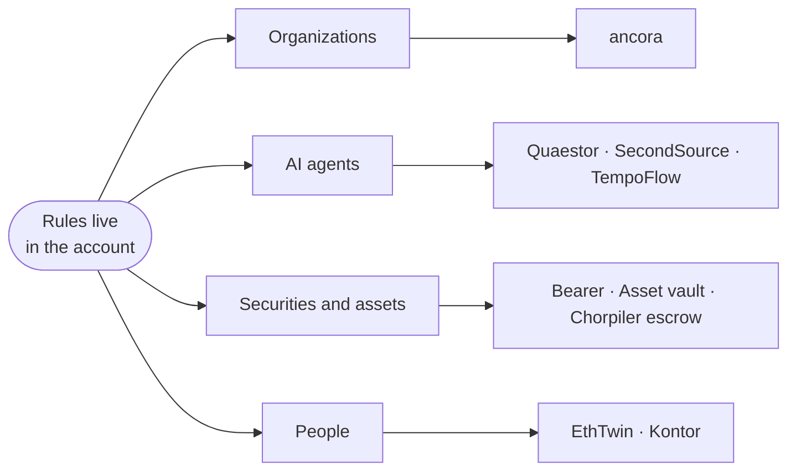

<!-- Animated typing banner -->

  <em>Financial software in which the rules live inside the account itself — 
  at the intersection of enterprise software, decentralized technology, AI, and regulation.</em>

<!-- Header badges -->

  
  
  
  
  

  

---

## 🧭 About Me

Business Informatics student at the **Technical University of Munich (TUM)** and founder of **ancora**. I build products around **programmable money**: shared accounts that enforce what an organization's members agreed on, budgets an AI agent cannot exceed, and securities that only move when a transfer is compliant.

I came to this from the finance and legal side, and that still decides what I build: products a treasurer, an issuer or a regulator could actually sign off on.

**One idea, four kinds of account holder:**

<table>
  <tr>
    <td>⚓</td><td><b>Founder of ancora</b> — the programmable business account for organizations</td>
  </tr>
  <tr>
    <td>🎓</td><td>B.Sc. <b>Business Informatics</b> (Wirtschaftsinformatik), TU&nbsp;Munich</td>
  </tr>
  <tr>
    <td>⚖️</td><td><b>Head of Legal &amp; Finance</b> — TUM Blockchain Club</td>
  </tr>
  <tr>
    <td>💼</td><td><b>SAP HCM Consultant</b> — enterprise HR systems</td>
  </tr>
  <tr>
    <td>📊</td><td>Several years in <b>finance, accounting &amp; corporate structuring</b></td>
  </tr>
  <tr>
    <td>🏆</td><td><b>Two hackathons won in 2026</b> — <a href="#-hackathon-wins">ETHPrague and Futura × Tempo</a></td>
  </tr>
</table>

---

## ⚓ Current Project — ancora

<a href="https://ancora-gray.vercel.app">
  <picture>
    <source media="(prefers-color-scheme: dark)" srcset="https://raw.githubusercontent.com/raglibol-re/ancora/main/app/public/brand/lockup-dark.svg" />
    
  </picture>
</a>

### The business account your organization controls.

A programmable stablecoin account for clubs, companies, NGOs and teams. 
Feels like a modern banking app; runs on **Stellar** in the background.

  
  
  

<table>
  <tr>
    <td width="33%" valign="top">

**🔑 One passkey per person**

Face ID, fingerprint or device PIN creates your account. No seed phrase, no wallet setup.

</td>
<td width="33%" valign="top">

**📜 One contract per organization**

Budgets, spending limits and approval rules are set by the members and enforced by the account itself.

</td>
<td width="33%" valign="top">

**🌍 Open source, built in the open**

Public preview on the Stellar testnet with test money, working towards mainnet with pilot organizations.

</td>
  </tr>
</table>

`TypeScript` · `Rust` · `Soroban` · `Stellar` · `Passkey smart accounts` · `Next.js`

---

## 🏆 Hackathon Wins

<em>Two first places in 2026, both for making on-chain payments usable by people who never asked for a wallet.</em>

 

<table>
  <tr>
    <td width="50%" valign="top" align="center">

### 🎙️ EthTwin

A <b>voice-first, AI-powered crypto interface</b> for people who have never used a wallet. You talk, your AI "Twin" acts: every user gets a persona at <code>&lt;name&gt;.ethtwin.eth</code> via <b>ENS</b>, a <b>passkey smart wallet</b> and <b>stealth-address</b> privacy. Built with a team.

`Next.js` · `TypeScript` · `viem` · `ENS` · `Account Abstraction` · `Claude`

<a href="https://github.com/danielshx/ethtwin">→ Repository</a>

</td>
<td width="50%" valign="top" align="center">

### 💸 TempoFlow

A content feed paid <b>by the second</b>, where money flows <b>both ways</b>: viewers stream sub-cent stablecoin payments to creators while an autonomous agent earns the amount back from advertisers, so watching costs the viewer close to nothing. Settled on the Tempo testnet.

`React` · `Vite` · `Hono` · `TypeScript` · `Tempo (TIP-20)`

<a href="https://github.com/raglibol-re/TempoFlow">→ Repository</a> &nbsp;•&nbsp; <a href="https://tempoflow-blue.vercel.app">→ Live demo</a>

</td>
  </tr>
</table>

---

## 🚀 Featured Projects

<em>Products and prototypes around the same idea, from agent budgets to tokenized securities.</em>

 

<table>
  <tr>
    <td width="50%" valign="top">

###  Quaestor
**Give your agent a mandate, not a wallet.**

Spending mandates for AI agents. A person funds a tree of agents, caps every branch and can freeze any of it at once; a sub-agent's limits can only be tighter than its parent's. Enforced on-chain, reached by agents over **MCP**.

`Solidity` · `Rust (Anchor)` · `TypeScript` · `Solana` · `Base` · `Tempo` · `Hyperliquid`

<a href="https://github.com/raglibol-re/Quaestor">→ Repository</a> &nbsp;•&nbsp; <a href="https://quaestor-landing.vercel.app">→ Site</a> &nbsp;•&nbsp; <a href="https://quaestor-dashboard.vercel.app">→ Dashboard</a>

</td>
<td width="50%" valign="top">

###  SecondSource
**Trust the primary source, not the headline.**

Checks a market-moving headline against **signed primary sources** before a trading agent acts on it, and answers confirmed, unconfirmed or denied with a receipt for every source. Payment settles only once the verdict is delivered.

`TypeScript` · `Solidity` · `x402` · `Cardano` · `Base`

<a href="https://github.com/raglibol-re/SecondSource">→ Repository</a> &nbsp;•&nbsp; <a href="https://secondsource-two.vercel.app">→ Live demo</a>

</td>
  </tr>
  <tr>
    <td width="50%" valign="top">

### 🏛️ Bearer
**Tokenized securities, compliance first** · *private*

Issuance and lifecycle platform for tokenized securities: one security specification, compliance checks before every issue, subscription and transfer, plus cap table and distributions. EU prospectus-exempt and German **eWpG** profiles. Prototype on testnets.

`TypeScript` · `PostgreSQL` · `XRPL` · `Stellar` · `Tempo` · `Linea`

</td>
<td width="50%" valign="top">

### 📈 Pretora
**Market intelligence for tradable goods** · *private*

Pricing and forecasting, starting with **used cars in Germany**: regional price differences, valuation of a single listing and ML-based price-index forecasts, wrapped in a natural-language assistant.

`Python` · `Machine Learning` · `TypeScript`

<a href="https://pretora.vercel.app">→ Live</a>

</td>
  </tr>
  <tr>
    <td width="50%" valign="top">

### 🚗 RE/AUTO
**Dealer storefront, CRM &amp; deal closing** · *private*

Multi-tenant platform for car dealers: a storefront each dealer can customize, with inventory, leads, appointments, documents and payments behind it.

`Next.js` · `TypeScript` · `PostgreSQL`

<a href="https://dealer-dashboard-ten.vercel.app">→ Live</a>

</td>
<td width="50%" valign="top">

### 🧾 OpenMerit
**Merit, with receipts.**

Evidence-first founder assessment for venture investors. Scores are shown as **intervals** rather than single numbers, every claim carries its sources, and the model writes the memo but never makes the decision.

`Next.js` · `TypeScript` · `Supabase` · `Vercel AI SDK`

<a href="https://github.com/raglibol-re/openmerit">→ Repository</a>

</td>
  </tr>
</table>

**More**

| Project | What it does | Stack |
| --- | --- | --- |
| [**chorpiler-escrow-settlement**](https://github.com/raglibol-re/chorpiler-escrow-settlement) | Research prototype: compiles BPMN&nbsp;2.0 choreographies into smart contracts and adds an escrow contract enabling **token transfers without messages** | `TypeScript` `Solidity` `Hardhat` |
| [**tokenized_assetvault**](https://github.com/raglibol-re/tokenized_assetvault) · [**tokenized_marketplace**](https://github.com/raglibol-re/tokenized_marketplace) | Earlier prototypes for holding, issuing &amp; trading tokenized real-world assets on Ethereum | `TypeScript` `Solidity` `Next.js` |
| [**Wer erbt?**](https://wer-erbt.vercel.app) · *private* | Draws a family tree and walks through intestate succession under German law (BGB §§&nbsp;1924–1930) | `Next.js` `TypeScript` `Neon` |
| [**Kontor**](https://kontor-eight.vercel.app) · *private* | AI-native finance app, early stage | `TypeScript` |

---

## 🛠️ Tech Stack

<b>Full stack by area</b>

 

**Languages**

**Web & Full-Stack**

**Blockchain & Payments**

**AI & Agents**

-D97757?style=flat-square&logo=claude&logoColor=white)

**Enterprise, Finance & Law**

-455A64?style=flat-square&logo=readthedocs&logoColor=white)

---

## 🔭 Currently

<table>
  <tr>
    <td width="33%" valign="top">

**🔨 Building**

ancora towards mainnet: reproducible releases, monitoring, an external security review and the first pilot organizations.

</td>
<td width="33%" valign="top">

**🧪 Exploring**

How far rules can go on-chain: spending mandates for agent trees, approvals over confidential amounts, compliant transfers of tokenized securities.

</td>
<td width="33%" valign="top">

**🤝 Open to**

Clubs, companies and NGOs that want to pilot ancora, and conversations about agent payments and tokenization under MiCAR and eWpG.

</td>
  </tr>
</table>

---

## 📫 Contact

  

<em>Open to pilots, collaborations and questions about any of the above.</em>

